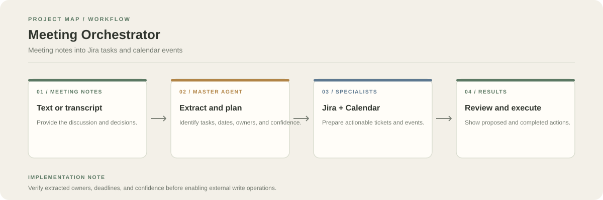

# Meeting Agentic AI

A unified orchestrator that analyses meeting notes and routes actionable items to specialised Jira and Google Calendar agents.

**Stack:** Python, Groq/Llama, Jira Cloud, Google Calendar



## Workflow

1. Submit meeting notes or a transcript.
2. The master agent extracts actions, dates, and follow-ups and prepares an execution plan.
3. Jira-related items are routed to the Jira agent; time-based items are routed to the Calendar agent.
4. The application returns extracted items, confidence information, and execution outcomes.

## Repository layout

- `unified_app.py`: unified entry point
- `Jira AI Agent/`: Jira integration
- `gc agent/`: Calendar integration

Module isolation matters because the specialist modules can contain files with the same names.

## Run

```bash
git clone https://github.com/chyk2468/Meeting-Agentic-AI.git
cd Meeting-Agentic-AI
```

Install the dependencies required by the bundled agent modules, configure Groq, Jira, and Google OAuth credentials, and launch the unified entry point:

```bash
python unified_app.py
```

Check the module-specific setup and credentials in each subfolder before running.

## Operational safety

Meeting summaries can be ambiguous. Review assignees, dates, and extracted action items before creating Jira tickets or calendar events. Do not put API keys, OAuth tokens, or meeting data containing sensitive information into version control.
