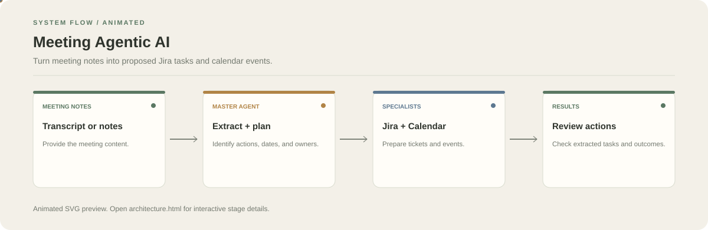

# Meeting Agentic AI

**Turn meeting notes into proposed Jira tasks and calendar events.**

[](https://github.com/chyk2468/Meeting-Agentic-AI)

## 1. Project Title & Tagline

Turn meeting notes into proposed Jira tasks and calendar events.

## 2. Problem Statement

Meeting follow-ups are easy to lose when decisions, owners, and deadlines stay buried in notes. This project routes extracted action items to specialised Jira and Calendar agents.

## 3. Project Preview

Add a real screenshot or short GIF of the current interface and a before/after result.

[Open interactive architecture](architecture.html)

## 4. Overview

The project accepts source content, runs the configured workflow, and presents a result for review. The diagram below summarises the main stages.

## 5. Key Features

- Analyse meeting notes and identify action items.
- Route ticket-related tasks to the Jira agent.
- Route time-based follow-ups to the Calendar agent.
- Return extracted items and action outcomes for review.

## 6. Architecture / Workflow



Open the [interactive architecture explorer](architecture.html) to select a stage and inspect its role.

## 7. Tech Stack

Python, Groq/Llama, Jira Cloud, Google Calendar API, Streamlit

## 8. Installation & Setup

```bash
git clone https://github.com/chyk2468/Meeting-Agentic-AI.git
cd Meeting-Agentic-AI
```

Install the dependencies required by the unified app and the bundled Jira and Calendar agent folders.

## 9. Usage

Configure the model key, Jira credentials, and Google OAuth flow expected by the bundled modules, then run `python unified_app.py`. Verify owners, deadlines, and event times before creating external records.

## 10. Project Structure

- `unified_app.py`: unified entry point
- `Jira AI Agent/`: Jira agent module
- `gc agent/`: Google Calendar agent module

## 11. Results & Demo

Add a demo using sample meeting notes and show the proposed Jira tasks and calendar events before any external changes are made.

## 12. Future Enhancements

- Add a review queue before write actions.
- Improve extraction of owners, dates, and decisions.
- Add tests for ambiguous notes and time zones.
- Keep module configuration and dependencies documented separately.

## 13. License

Check the repository and each bundled module's licence. Keep API keys and OAuth tokens out of version control.
